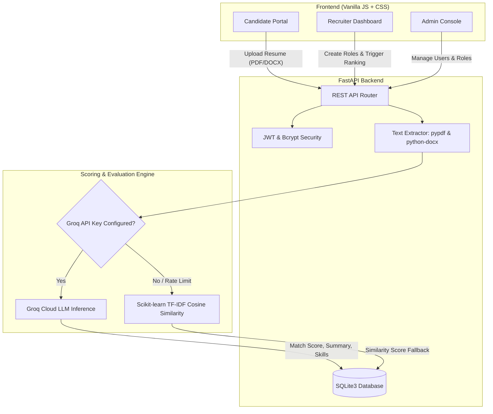

# ShortList — AI-Powered Resume Ranker & Screening System

[](https://fastapi.tiangolo.com)
[](https://www.python.org/)
[](https://groq.com/)
[](https://www.sqlite.org/)
[](https://opensource.org/licenses/MIT)

 **"Read 200 resumes in the time it takes to read one."**  
 An intelligent, full-stack recruitment platform that automatically parses candidate resumes, matches them against job descriptions using Groq-accelerated LLMs, and ranks applicants with detailed scores and actionable feedback.

---

## Highlights

- **Ultra-Fast AI Scoring**: Integrates Groq LLM inference (`openai/gpt-oss-120b` or custom models) for near-instant structured candidate evaluation.
- **Smart Offline Fallback**: Zero downtime — seamlessly falls back to local Scikit-Learn TF-IDF cosine similarity ranking if AI API limits are hit or credentials are absent.
- **Objective & Unbiased Criteria**: Evaluates purely on skills, domain fit, and relevant experience while explicitly ignoring protected demographic attributes.
- **Prompt Injection Resistant**: Hardened prompt boundaries treat untrusted resume documents as plain data to prevent jailbreak attempts.
- **Multi-Role RBAC**: Distinct workflows for **Candidates**, **Recruiters**, and **Admins** powered by secure JWT Bearer tokens and bcrypt password hashing.
- **Multi-Format Parsing**: Instant text extraction for `.pdf` (pypdf), `.docx` (python-docx), and `.txt` files up to 5MB.
- **Zero-Build Lightweight UI**: Elegant, responsive SPA built with modern Vanilla JavaScript and CSS — no npm or heavy bundle pipelines required.

---

## Architecture & Workflow



---

## User Roles & Features

| Role | Key Capabilities |
| :--- | :--- |
| **Candidate** | • Browse open job openings<br>• Upload resumes (`.pdf`, `.docx`, `.txt`)<br>• Track application status (*Received* vs. *Reviewed*) |
| **Recruiter** | • Post and delete job vacancies with role descriptions<br>• View all applications per role in a unified dashboard<br>• One-click rank new candidates or re-rank all applicants<br>• Inspect fit scores (0–100), matched skills, missing skills, and AI summaries |
| **Administrator** | • Oversee all job listings across organizations<br>• User management (view and delete candidate/recruiter accounts)<br>• Bootstrap admin account automatically via environment variables |

---

## Tech Stack

- **Backend Framework**: [FastAPI](https://fastapi.tiangolo.com/) (Python 3.10+)
- **Server**: [Uvicorn](https://www.uvicorn.org/) ASGI
- **AI / LLM Engine**: [Groq Cloud API](https://groq.com/) (Fast inference with JSON output formatting)
- **NLP / ML Fallback**: [scikit-learn](https://scikit-learn.org/) (TF-IDF Vectorizer & Cosine Similarity)
- **Document Extractors**: `pypdf`, `python-docx`
- **Database**: SQLite3 with foreign keys enabled
- **Security & Auth**: `PyJWT` (HS256 Bearer tokens), `bcrypt`
- **Frontend**: Vanilla HTML5, Modern CSS3 (Grid & Flexbox), Vanilla ES6 JavaScript (Zero dependencies)

---

## Project Structure

```text
Resume-Ranker/
├── backend/
│   ├── .env                  # Environment secrets (Groq API, JWT, Admin config)
│   ├── main.py               # FastAPI application, DB models, AI & TF-IDF logic
│   └── requirements.txt      # Python dependencies
├── frontend/
│   ├── app.js                # Single Page Application (SPA) state & API client
│   ├── index.html            # Entry HTML & auth layout
│   └── style.css             # Design system, responsive styles & components
├── .gitignore                # Git ignore rules for Python, SQLite & environment files
└── README.md                 # Project documentation
```

---

## Getting Started

### 1. Prerequisites

- **Python 3.10+** installed on your system.
- *(Optional)* A free **Groq API Key** from [console.groq.com](https://console.groq.com/) for AI-powered semantic scoring. *(If omitted, the app will automatically use TF-IDF keyword matching).*

### 2. Clone the Repository

```bash
git clone https://github.com/<your-username>/resume-ranker.git
cd resume-ranker
```

### 3. Set Up Virtual Environment

#### On Windows (PowerShell):
```powershell
python -m venv venv
.\venv\Scripts\Activate.ps1
```

#### On macOS / Linux:
```bash
python3 -m venv venv
source venv/bin/activate
```

### 4. Install Dependencies

```bash
pip install -r backend/requirements.txt
```

### 5. Configure Environment Variables

Create or edit `backend/.env` with your settings:

```ini
# Groq API Configuration (for AI-powered evaluations)
GROQ_API_KEY=your_groq_api_key_here
GROQ_MODEL=openai/gpt-oss-120b

# Security Secrets
JWT_SECRET=super-secret-jwt-signing-key-replace-in-production

# Optional Admin User Auto-Creation on Startup
ADMIN_EMAIL=admin@example.com
ADMIN_PASSWORD=SuperSecurePassword123!

# Database Path (defaults to resumes.db inside backend directory)
DB_PATH=resumes.db
```

### 6. Run the Application

Start the FastAPI application using Uvicorn:

```bash
cd backend
uvicorn main:app --reload --host 0.0.0.0 --port 8000
```

Open your browser and navigate to:
```
http://localhost:8000
```

 **Interactive API Docs**: Explore the Swagger UI directly at `http://localhost:8000/docs`

---

## API Endpoints

### Authentication
| Method | Endpoint | Description | Access |
|---|---|---|---|
| `POST` | `/api/auth/register` | Register a new recruiter or candidate | Public |
| `POST` | `/api/auth/login` | Sign in with email and password | Public |
| `GET` | `/api/auth/me` | Fetch currently authenticated user | Authenticated |

### Jobs
| Method | Endpoint | Description | Access |
|---|---|---|---|
| `GET` | `/api/jobs` | List available jobs / recruiter posted jobs | Authenticated |
| `POST` | `/api/jobs` | Create a new job requisition | Recruiter, Admin |
| `DELETE` | `/api/jobs/{id}` | Delete a job requisition | Recruiter (Owner), Admin |

### Applications & Ranking
| Method | Endpoint | Description | Access |
|---|---|---|---|
| `POST` | `/api/jobs/{id}/apply` | Submit resume (`.pdf`, `.docx`, `.txt`) | Candidate |
| `GET` | `/api/my-applications` | View candidate's submitted applications | Candidate |
| `GET` | `/api/jobs/{id}/applications` | View candidate ranking & scores for a job | Recruiter, Admin |
| `POST` | `/api/jobs/{id}/rank` | Trigger AI / TF-IDF scoring for applicants | Recruiter, Admin |

### Administration
| Method | Endpoint | Description | Access |
|---|---|---|---|
| `GET` | `/api/admin/users` | List all registered users | Admin |
| `DELETE` | `/api/admin/users/{id}` | Delete a user account and associated data | Admin |

---

## How the Ranking Algorithm Works

1. **Text Extraction**: The document is uploaded and read in memory. Text is normalized and checked for minimum content length (protects against empty or purely scanned documents).
2. **AI Semantic Scoring (Primary)**:
   - When a valid `GROQ_API_KEY` is present, the backend constructs a structured prompt pairing the job description with candidate resume data.
   - The LLM assesses:
     - Core competency alignment
     - Practical domain experience & seniority
     - Matched and missing technical/soft skills
   - Returns a structured JSON payload with score (0–100), concise summary, matched skills array, and missing skills array.
3. **TF-IDF Offline Fallback (Secondary)**:
   - If Groq is unconfigured or returns repeated 429 rate limits, the system seamlessly applies TF-IDF n-gram vectorization and cosine similarity.
   - Flags the evaluation method as `keyword` in the UI to ensure total transparency.

---

## Security & Privacy

- **Data Privacy**: Resumes are converted to text and stored locally in your SQLite database. No external tracking or storage outside your Groq API calls.
- **Fair Screening**: The system prompt explicitly enforces non-discriminatory evaluations, strictly ignoring protected attributes (gender, age, ethnicity, nationality).
- **Prompt Injection Defense**: Resume content is isolated into user message blocks and labeled as untrusted input to mitigate prompt injection.
- **Password Protection**: Passwords hashed using standard `bcrypt` with unique salts.

---

## Contributing

Contributions are welcome! Please follow these steps:

1. Fork the Project
2. Create your Feature Branch (`git checkout -b feature/AmazingFeature`)
3. Commit your Changes (`git commit -m 'Add some AmazingFeature'`)
4. Push to the Branch (`git push origin feature/AmazingFeature`)
5. Open a Pull Request

---

## License

Distributed under the MIT License. See `LICENSE` for more information.
